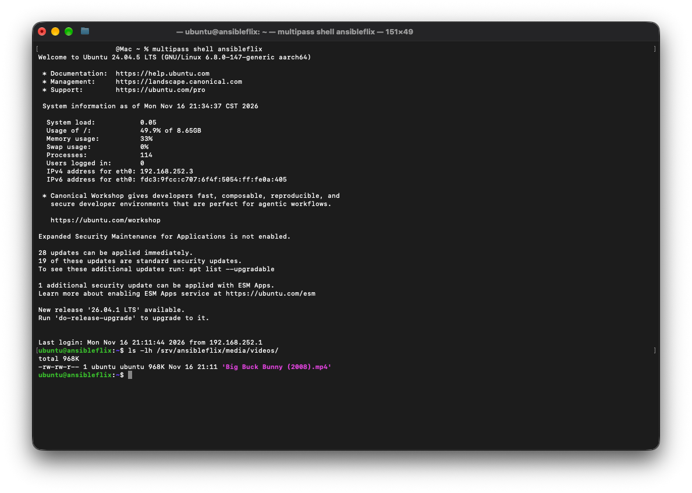

# AnsibleFlix

**AnsibleFlix** is a self-hosted media streaming and health-monitoring stack provisioned with **Ansible** from a macOS control node onto a local Ubuntu VM running via [Canonical Multipass](https://canonical.com/multipass).

It deploys two open-source Dockerized services inside the VM:
- **[Jellyfin](https://jellyfin.org/) (`:8096`)**: Personal media streaming server with host-mounted media directories and hardware-aware memory limits.
- **[Uptime Kuma](https://github.com/louislam/uptime-kuma) (`:3001`)**: Service health dashboard monitoring Jellyfin's uptime.

## Key Ansible Concepts Covered
- **Agentless SSH & Inventory**: Connecting from macOS to the Multipass VM (`inventory/hosts.ini`).
- **Modular Roles**:
  - `common_host`: Installs Docker (`when: ansible_facts['os_family']`), checks free disk space (`register` + `assert`), and creates media directories.
  - `jellyfin_media`: Renders environment configuration via Jinja2 templates (`ansible.builtin.template`), deploys Jellyfin (`community.docker.docker_container`), and restarts on config changes via handlers.
  - `uptime_watchdog`: Deploys Uptime Kuma and probes Jellyfin's `/health` endpoint (`ansible.builtin.uri`).
- **Secret Management**: Encrypts credentials in `inventory/group_vars/all/vault.yml` using `ansible-vault`.
- **Self-Tests & Idempotency**: Verifies HTTP endpoints and directory state in `site.yml` `post_tasks` and passes `ansible-lint`.

## Quick Start

```bash
# 1. Install collection dependencies
ansible-galaxy collection install -r requirements.yml

# 2. Test SSH connectivity to the VM
ansible media_servers -m ansible.builtin.ping

# 3. Deploy the stack
ansible-playbook site.yml
```

## Documentation (`docs/`)

| Document | Summary |
| :--- | :--- |
| [`docs/PLAN.md`](docs/PLAN.md) | Architecture overview, functional & technical requirements, role breakdown, testing strategy, and Definition of Done. |
| [`docs/BUILD_INSTRUCTIONS.md`](docs/BUILD_INSTRUCTIONS.md) | Step-by-step DIY guide covering Multipass VM setup, Ansible Vault creation, writing each role from scratch, and verification. |
| [`docs/RESTORE_MANAGED_NODE.md`](docs/RESTORE_MANAGED_NODE.md) | How to stop/start the Multipass VM, handle DHCP IP changes in `inventory/hosts.ini`, and preserve VM data across reboots. |

## Demo (`docs/Demo/`)

### Media File on the Managed VM


### Video Walkthroughs
- **Stack & Dashboard Demo**: [`docs/Demo/Demo.mov`](docs/Demo/Demo.mov)
- **Big Buck Bunny Playback in Jellyfin**: [`docs/Demo/BBB_Demo.mov`](docs/Demo/BBB_Demo.mov)

<video src="docs/Demo/Demo.mov" controls width="720"></video>

<video src="docs/Demo/BBB_Demo.mov" controls width="720"></video>
